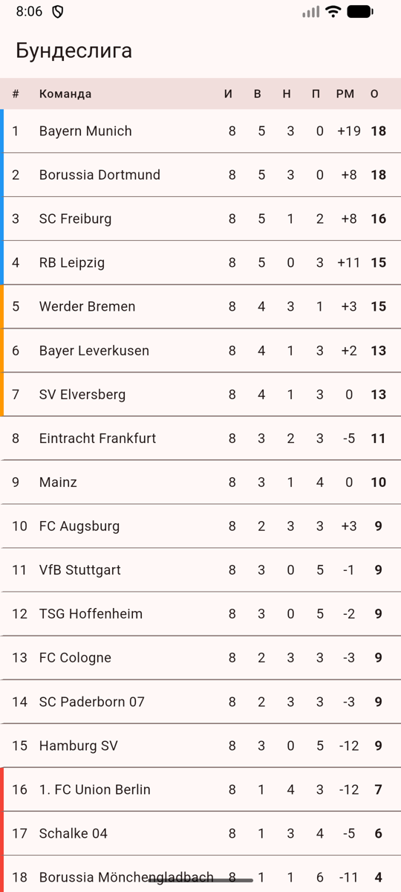
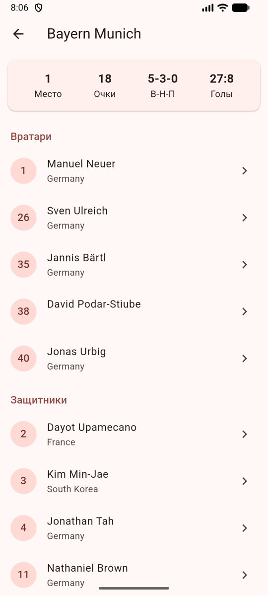
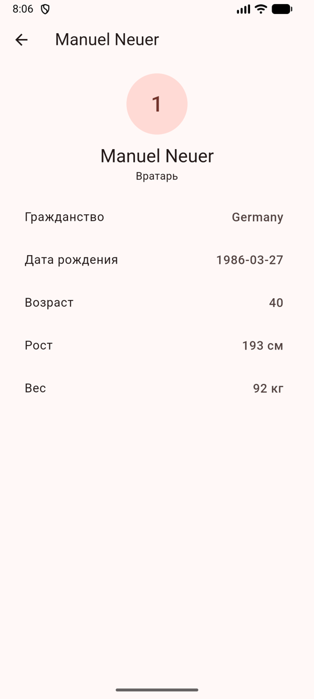
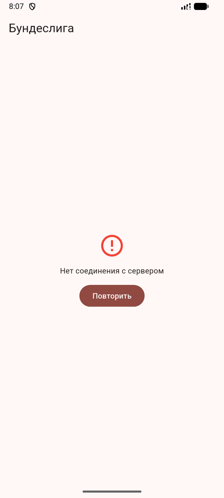
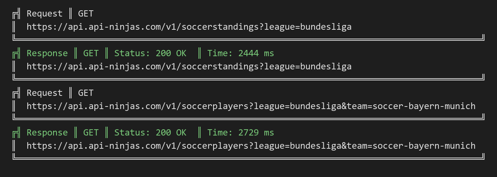

# bundesliga_flutter

Приложение «Бундеслига» на Flutter: турнирная таблица, составы клубов и карточки игроков из API · *Bundesliga app in Flutter: standings, squads and player cards from a REST API*

`Flutter` `Dart` `Dio` `pretty_dio_logger` `get_it` `flutter_dotenv` `Material 3`

<p align="center">
  
  
  
  
</p>

## Что сделано
- **Турнирная таблица Бундеслиги:** место, игры, победы, ничьи, поражения, разница мячей, очки. Цветная полоса отмечает Лигу чемпионов, другие еврокубки и зону вылета. Обновление жестом сверху вниз
- **Состав клуба** по нажатию на команду: карточка со статистикой команды, игроки сгруппированы по позициям (вратари, защитники, полузащитники, нападающие) и отсортированы по номеру
- **Карточка игрока:** номер, позиция, гражданство, дата рождения, возраст, рост, вес
- **Работа с сетью через Dio:**
  - `ApiKeyInterceptor` сам добавляет заголовок `X-Api-Key` к каждому запросу;
  - `PrettyDioLogger` печатает запросы и ответы в консоль (заголовки отключены, чтобы не светить ключ);
  - тайм-ауты 10 секунд
- **Зависимости через `get_it`:** `Dio` и `FootballApi` регистрируются один раз в `setupLocator`, экраны берут их через `getIt<FootballApi>()`
- **Ошибки:** неверный ключ, лимит запросов, нет соединения — понятное сообщение и кнопка «Повторить»
- **Ключ API в `.env`:** файл в `.gitignore`, в репозитории только шаблон `.env.example`

Данные: Football API сервиса [api-ninjas.com](https://api-ninjas.com) (бесплатный план, текущий сезон).

<p align="center">
  
</p>

## Структура
```
lib/
├── main.dart                    # загрузка .env, setupLocator, MaterialApp
├── api/
│   ├── api_key_interceptor.dart # добавляет X-Api-Key в заголовок
│   └── football_api.dart        # запросы таблицы и состава
├── di/
│   └── locator.dart             # get_it: Dio + интерсепторы, FootballApi
├── models/
│   ├── standing.dart            # строка турнирной таблицы
│   └── player.dart              # игрок, позиция на русском
├── screens/
│   ├── standings_screen.dart    # таблица
│   ├── squad_screen.dart        # состав по позициям
│   └── player_screen.dart       # карточка игрока
└── widgets/
    └── error_view.dart          # сообщение об ошибке + «Повторить»
```

## Запуск
1. Получить бесплатный ключ на [api-ninjas.com](https://api-ninjas.com)
2. Скопировать `.env.example` в `.env` и вписать ключ:
   ```
   API_KEY=ваш_ключ
   ```
3. Запустить:
   ```bash
   flutter pub get
   flutter run
   ```

Без файла `.env` проект не соберётся: он подключён как asset в `pubspec.yaml`.

---

## English

A Flutter app that shows the Bundesliga table, club squads and player details from the api-ninjas.com Football API.

### Features
- **Standings:** rank, played, W/D/L, goal difference, points; colored markers for Champions League, other European spots and relegation; pull to refresh
- **Squad** on team tap: team summary card, players grouped by position and sorted by shirt number
- **Player card:** number, position, nationality, birth date, age, height, weight
- **Networking with Dio:**
  - `ApiKeyInterceptor` adds the `X-Api-Key` header to every request;
  - `PrettyDioLogger` logs requests and responses (headers off so the key is not printed);
  - 10-second timeouts
- **Dependency injection with `get_it`:** `Dio` and `FootballApi` are registered once in `setupLocator`
- **Errors:** invalid key, rate limit, no connection, with a Retry button
- **API key in `.env`:** gitignored; only `.env.example` is committed

### Run
Copy `.env.example` to `.env`, put your api-ninjas.com key in it, then `flutter pub get` and `flutter run`.
